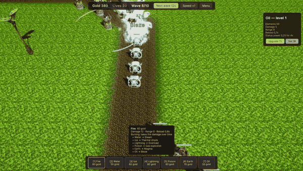
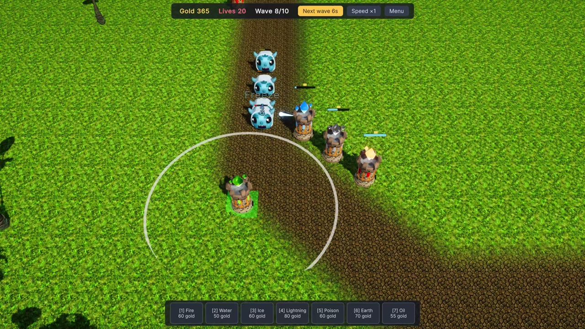
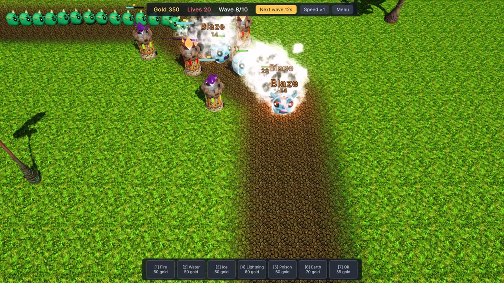

# Battle of the Elements

**A co-op tower defense for 1–4 players where elements react with each other.**

[**▶ Play in browser**](https://llarean.org/tower-defense/) · [**⬇ Download for Windows**](https://github.com/LLarean/tower-defense/releases/latest)

 

Water a crowd and shock it, freeze a column and shatter it, poison a pack and set the gas on fire.
Seven elements put a status on a monster; a second element on the same monster triggers one of fifteen reactions.

## Features

- **Element reactions** — fire, water, ice, lightning, poison, earth and oil combine into steam, superconduct, magma, wildfire and more.
- **Co-op for 1–4 players** — host online and share a code, or play over a local network. Separate gold, shared lives, split bounty.
- **Campaign** — "The Last Architects": three missions with a prologue, briefings and a boss siege.
- **Three difficulties** — every mission on Easy, Normal or Hard, solo or together.
- **English and Russian** — follows the system language, switchable in settings.

  
  

## Download

- **Browser** — [llarean.org/tower-defense](https://llarean.org/tower-defense/), no install. Online co-op by code is available here too; local network play needs the Windows build.
- **Windows** — the zip from the [latest release](https://github.com/LLarean/tower-defense/releases/latest): unpack and run `BattleOfTheElements.exe`.

## Play

| Input | Action |
|---|---|
| `1`…`7` or the bottom bar | Pick a tower to build |
| Left click | Build, select a tower or a monster |
| Right click, `Esc` | Cancel; `Esc` again opens the menu |
| `U`, `X` | Upgrade or sell the selected tower |
| `Space` | Start the battle or call the next wave early |
| `WASD`, screen edges, wheel | Move and zoom the camera |

The full table of elements and reactions is in [docs/DESIGN.md](docs/DESIGN.md).

## Under the hood

- **Engine-free core** — the whole simulation lives in plain C# (`Assets/Game/Scripts/Core`) and is tested with `dotnet test`, no editor needed.
- **Deterministic lockstep** — only player orders travel over the network; every peer runs the same simulation and checksums catch divergence.
- **Data-driven** — towers, monsters, chemistry, levels and the campaign are ScriptableObjects in `Assets/Game/Config`.

| Path | What |
|---|---|
| `Assets/Game/Scripts/Core` | Simulation: monsters, statuses, reactions, towers, waves, economy, lockstep |
| `Assets/Game/Scripts/Stage` | Unity side: scenes, views, input, HUD, effects, networking |
| `Assets/Game/Scripts/Editor` | Map forge that sculpts, paints and plants terrain around routes |
| `tools` | `dotnet` projects that build and test the code without the editor |

## Develop

1. Open the project in Unity `6000.3.12f1`.
2. Run core tests: `dotnet test tools/CoreTests`.
3. Check the Unity layer compiles: `dotnet build tools/Stage` and `dotnet build tools/Editor`.

Online co-op needs the project linked to Unity Cloud: *Edit → Project Settings → Services*.
Code rules are in [docs/CODESTYLE.md](docs/CODESTYLE.md), ready-made patterns in [docs/PATTERNS.md](docs/PATTERNS.md), the state and plan in [docs/STATUS.md](docs/STATUS.md).

## Credits

- Monsters — [Quaternius](https://quaternius.com), CC0.
- Sounds — [Kenney](https://kenney.nl), CC0.
- Skybox — Midgard Skybox by LaFinca Studio; crystals — Translucent Crystals by SineVFX; Unity Particle Pack (Unity Asset Store EULA).
